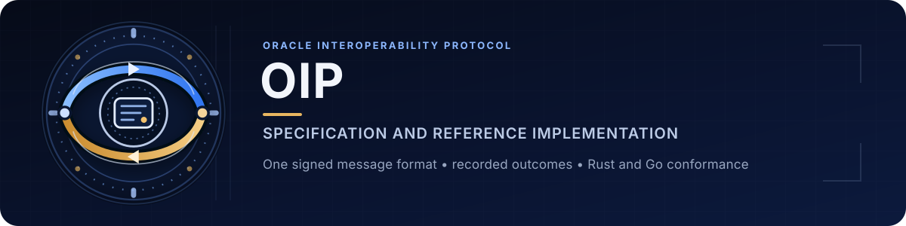
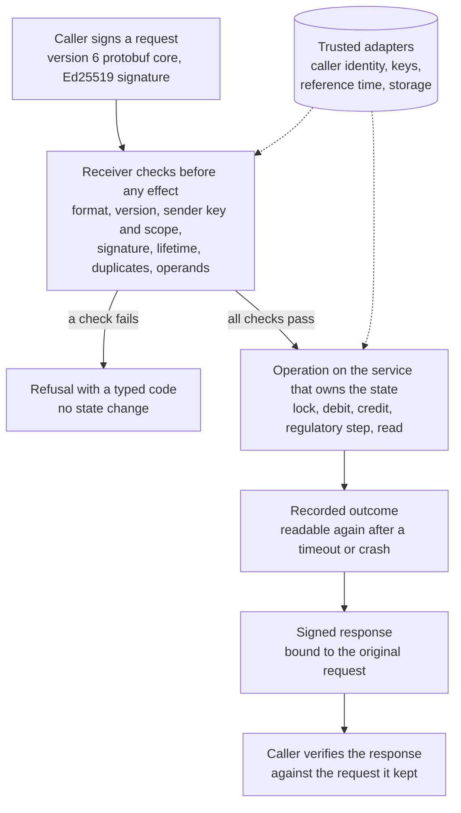

<div align="center">
  <picture>
    <source media="(max-width: 900px)" srcset="docs/assets/oip-spec-banner-mobile.svg">
    
  </picture>

  <p><strong>The Oracle Interoperability Protocol: message semantics, state transitions, routing, validation, errors and conformance rules for state-machine implementations.</strong></p>

  [](https://github.com/Oraclizer/oip-spec/actions/workflows/tests.yml)
  [](https://github.com/Oraclizer/oip-spec/actions/workflows/repository-health.yml)
  [](https://github.com/Oraclizer/oip-spec/actions/workflows/tests.yml)
  [](https://github.com/Oraclizer/oip-spec/actions/workflows/tests.yml)
  [](LICENSE)

  [Specification](#specification-documents) |
  [Quickstart](#quickstart) |
  [Architecture](#architecture) |
  [Versions](#versions-and-compatibility) |
  [Assurance](#assurance) |
  [Changelog](CHANGELOG.md)
</div>

> **Unaudited. Not for production.** OIP v0.6.0 is a prototype-stage
> specification draft. The Rust and Go code here makes its rules executable
> and testable. It is reference code without a security audit, and this
> repository describes no deployment.

## Why OIP

A transfer, a lock or a regulatory order often has to change state in two
places at once: on a chain and in an off-chain system that keeps its own
records. Each side learns about the other through messages, and messages can
arrive late, twice, out of order or from the wrong sender. Two
implementations can also read the same bytes differently. When either
happens, one side records an effect that the other never sees.

OIP defines one signed message format and the checks a receiver applies
before anything changes: the sender's key and scope, the protocol version
both peers negotiated, the message lifetime, duplicate detection and the
layout of each operation. Accepted calls end in recorded outcomes that the
caller can read again after a timeout or a crash, so a retry returns the
earlier result and does not repeat the effect.

Both sides can check the result. A caller verifies a signed response against
the request it kept, and shared test vectors hold implementations in
different languages to the same results. This repository contains the rules,
the vectors, a Rust reference implementation and a Go implementation of the
message layer.

## Quickstart

You need [rustup](https://rustup.rs/) and Go 1.25.5. The generated-code
check also needs Python 3, protoc 33.5 and protoc-gen-go v1.36.8, as
described in [CONTRIBUTING.md](CONTRIBUTING.md#development-checks).

```bash
git clone https://github.com/Oraclizer/oip-spec.git
cd oip-spec
rustup toolchain install 1.96.1 --profile minimal
cargo +1.96.1 test --locked
(cd go && go test -mod=readonly ./...)
```

Both test commands report `ok`. The Rust suite runs the reference against the
vectors in [`tests/vectors/`](tests/vectors/). Tests that need live etcd
clusters, mutual TLS stores or recorded archives are marked ignored. List
them with:

```bash
cargo +1.96.1 test --locked -- --list --ignored
```

## Architecture



The schema in [`proto/oip.proto`](proto/oip.proto) generates the Rust
bindings in `src/wire/generated.rs` and the Go bindings in `go/wirepb/`.
Both implementations check the original bytes before the generated parser
reads them, so duplicate fields, unknown fields and competing alternatives
are refused before they can be normalized. The word layout of every
operation is in [`spec/operations.md`](spec/operations.md).

## Versions and compatibility

| Version | Defined in | Treatment in this repository |
| --- | --- | --- |
| v0.6.0, wire version 6 | [`spec/`](spec/) and [`proto/oip.proto`](proto/oip.proto) | Current draft. Signed protobuf messages; the reference profile signs with Ed25519 |
| v0.5 | [OIP v0.5 documentation](https://docs.oraclizer.io/oip-v05/oip-overview/) | Used only with an authenticated, permitted legacy peer and an explicitly configured codec for the common Query and Heartbeat operations. The codec is a reference compatibility record and does not interoperate with the wire format in the published v0.5 documentation |
| Any other version | | Refused with `UNSUPPORTED_VERSION`. Parse, signature, timeout and rejection errors never select another version |

The Ed25519 reference configuration accepts 25 of the 31 operations and
refuses the other six with `UNSUPPORTED_VERSION` before admission; the
[reference configuration](spec/operations.md#reference-configuration) lists
them.

| Component | Pinned version |
| --- | --- |
| Rust | 1.96.1, edition 2024; dependency versions pinned in `Cargo.toml` and `Cargo.lock` |
| Go | 1.25.5 with `google.golang.org/protobuf` v1.36.8 |
| Code generation | protoc 33.5 and protoc-gen-go v1.36.8 |

A SINGLE signature uses Ed25519 in the reference profile. A THRESHOLD
signature requires a configured adapter that enforces distinct, currently
authorized signers and a trusted quorum. This repository contains no
threshold adapter, so the reference refuses threshold requests with
`INVALID_THRESHOLD_SIGNATURE`.

## Assurance

| Check | Command | A pass shows |
| --- | --- | --- |
| Rust reference tests | `cargo +1.96.1 test --locked` | The reference produces the expected results and refusals, including on the shared vectors. Ignored tests are listed in the log and not run |
| Go tests | `go test -mod=readonly ./...` in `go/` | The Go message layer decodes, checks and refuses the vector frames as specified |
| Generated bindings | `python3 scripts/generate-wire.py --check` with the pinned generators | The committed Rust and Go bindings are byte-identical to the pinned generators' output |
| Operation table | `python3 scripts/render-operations.py --check` | [`spec/operations.md`](spec/operations.md) matches its source table |
| Operation conformance | `python3 scripts/check-operations.py` | Table-derived frames and seeded transport mutations agree between Rust, Go and the independently pinned executable model; missing or stale model inputs fail |
| Signed interoperation | `python3 scripts/test-wire-interop.py` | Rust and Go exchange signed frames, including execution at the Rust persistent authority |
| Repository health | `node .github/scripts/verify-repository-health.mjs` | Links, vector checksums, workflow pins and public-text rules hold |
| Formal models | [Proof source and scope](https://github.com/Oraclizer/formal-verification/tree/main/Oracle_Interoperability_Protocol) | The proof artifact states the model, its assumptions and the implementation boundary |

A hosted result applies to the commit it ran on. The checks do not
establish:

- an independent security audit;
- a deployment, an operator procedure or a key-management process;
- threshold signatures, which need an adapter that this repository does not
  contain;
- the behavior covered by tests that need live services, because CI does not
  run them;
- a machine-checked link between the Rust or Go code and a formal model;
- any legal or regulatory fact. Regulatory operations carry decisions made
  outside the protocol, and OIP checks and records those decisions.

## Specification documents

| Document | Covers |
| --- | --- |
| [Common product model](spec/product-model.md) | Request identity and binding, crash and recovery, interleaving |
| [Message format and version profiles](spec/wire-conformance.md) | Version negotiation, the signed message, admission and retry, responses, field numbers and operands |
| [Operation operands](spec/operations.md) | Word layout of all 31 operations, generated from [`operations.json`](spec/operations.json) |
| [Lock and finality rules](spec/lock-finality.md) | Lock ownership, source attestations, pending amounts and terminal evidence |
| [Identity and ownership handover](spec/identity-handover.md) | Caller and endpoint identity, Ed25519 reference keys, owner and session handover |
| [Persistence and recovery](spec/persistent-recovery.md) | Durable commits, the etcd control transport, archive selection, retained results and unresolved effects |
| [Outcomes and publication](spec/authoritative-outcomes.md) | Call identity and completion, consumption of original events, publication and settlement |
| [Current and historical reads](spec/current-and-historical-reads.md) | Current and historical observations |
| [Regulatory execution](spec/regulatory-execution.md) | Trusted reference time, regulatory entry and spending under a completed freeze |
| [Compatible service actions](spec/parallel-composition.md) | When two actions may run in either order with the same state and replies |

## Repository map

| Path | Purpose |
| --- | --- |
| `spec/` | Normative rules, one document per topic, and the operation table with its schema |
| `proto/oip.proto` | Message schema; the Rust and Go bindings are generated from it |
| `src/` | Rust reference: product boundary, message layer, recovery and handover profiles |
| `examples/wire_corpus.rs` | Prints the signed message corpus used to compare Rust and Go |
| `go/` | Go message layer: byte checks, admission, operands, the v0.5 compatibility codec and a corpus generator |
| `tests/vectors/` | Shared test vectors, each with a SHA-256 checksum file |
| `scripts/` | Binding generation, operation-table rendering and the Rust and Go exchange script |
| `docs/assets/` | README banner |
| `.github/` | Workflows, the repository health checker, and issue and pull request templates |

## Executable conformance boundaries

The normal [wire value comparison](tests/wire-values.md) requires actual Rust,
Go and the independently pinned exported model to agree on transport decisions,
retained bytes, decoded typed values, canonical re-encoding, signing preimages
and transport keys. The fixed/seeded corpus has 673 inputs. Old accept-only
exports cannot satisfy its distinct typed-value ABI.

The Rust reference path also checks the original typed product-result,
preimage and response-byte boundary through the independently pinned Full
sender/current-client model. Source-only signed-response regressions and
limited result converter fixtures remain distinct from that model comparison.
The [full consumer contract](tests/full-response-consumer.md) distinguishes
model primitive requests, actual signer attempts and scoped source provenance.

Financial/internal product replay consumers remain explicitly separate prepared
work. See the [artifact contract](tests/model-artifact.md),
[source regression interface](tests/reference-execution.md) and
[pinned Linux recipe](tests/linux-model-runtime.md).

## Security, contributing and support

- Report suspected vulnerabilities privately through [SECURITY.md](SECURITY.md).
  Do not disclose exploit details in a public issue.
- [CONTRIBUTING.md](CONTRIBUTING.md) explains which changes are welcome, the
  local checks and how long they take.
- [SUPPORT.md](SUPPORT.md) separates usage questions from defects and
  security reports.
- [GOVERNANCE.md](GOVERNANCE.md) records who decides and how changes merge.
- Participation follows the [Code of Conduct](CODE_OF_CONDUCT.md).

## License and citation

Licensed under the [Apache License 2.0](LICENSE).
Copyright Oraclizer Labs, Inc.

[DISCLAIMER.md](DISCLAIMER.md) summarizes the research, deployment and legal
boundaries in plain language. Cite the specification with
[CITATION.cff](CITATION.cff) and name the commit you used.

Maintainer: Jinwook Kim (Jay), `jay@oraclizer.io`.
